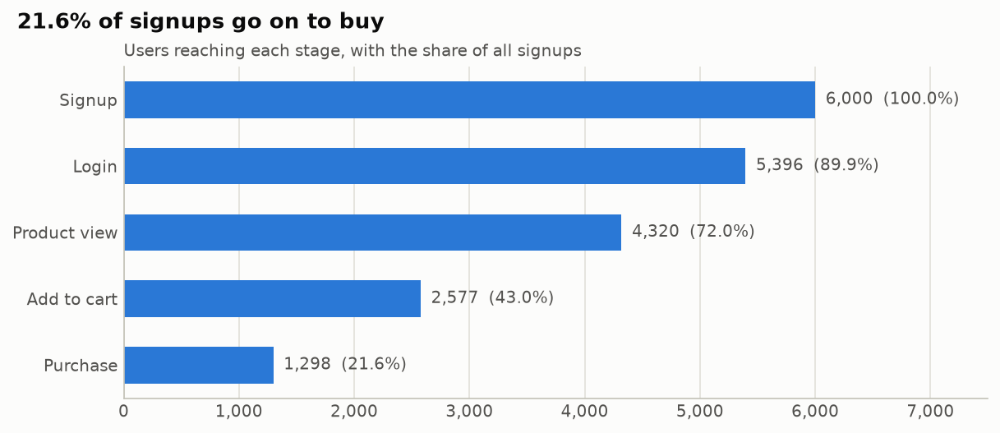
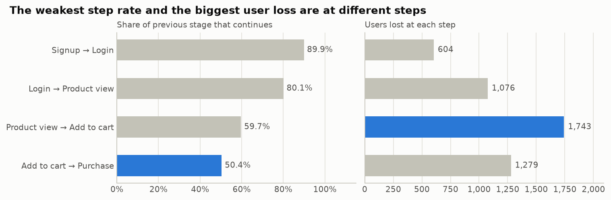
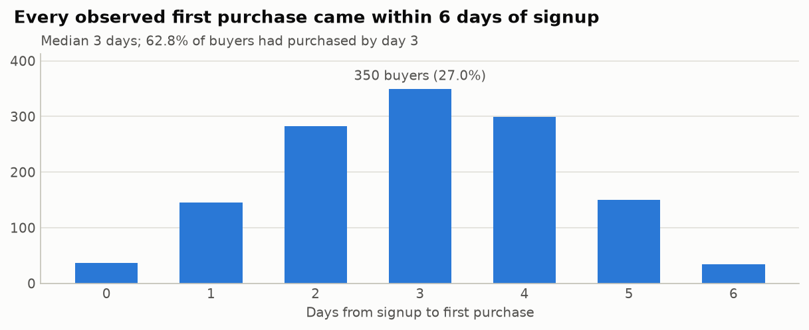
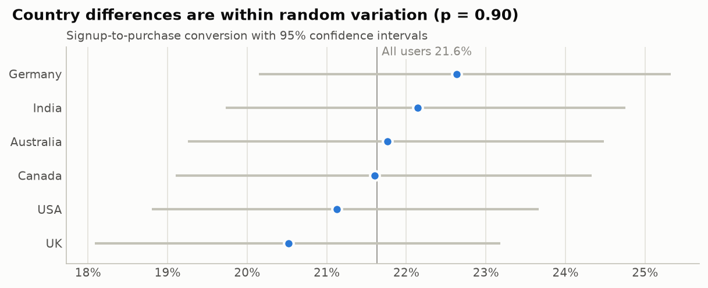

# E-commerce Funnel Analysis

[](https://github.com/omkark2404/ecommerce-funnel-analytics/actions/workflows/ci.yml)
[](https://nbviewer.org/github/omkark2404/ecommerce-funnel-analytics/blob/main/notebooks/funnel_analysis.ipynb)

Where do users drop out between signing up and buying, how fast do buyers convert, and does any segment behave differently? This project answers those questions for 6,000 accounts and 19,591 events across a five-stage funnel: **signup → login → product view → add to cart → purchase**.

**Tools:** MySQL 8.4 (CTEs, window functions) · Python (pandas, SciPy, matplotlib) · Jupyter · Docker Compose · GitHub Actions

**Full analysis:** [notebooks/funnel_analysis.ipynb](notebooks/funnel_analysis.ipynb)

## Key findings

1. **21.6% of signups make a purchase** (1,298 of 6,000).
2. **The weakest step is add to cart → purchase** ("checkout" for short): only 50.4% of users with a cart go on to buy. One extra percentage point there is worth about 26 purchases per 6,000 signups, against about 22 at product view → add to cart. That ranking follows directly from the step rates (the gain from one point is 1% of purchases divided by the step's rate), so it is one finding, not two.
3. **The most users are lost earlier, between product view and add to cart:** 1,743 users, against 1,279 after add to cart. More people reach that step, so a better rate still loses more users.
4. **Every buyer purchased within a day of adding to cart,** and every first purchase came within 6 days of signup (median 3). Both follow from how tightly the steps are spaced in this sample (see Data and limitations), so they describe the sample rather than buyer psychology. Among users with a full week of follow-up, 21.5% bought within 7 days.
5. **No segment stands out.** Conversion ranges from 20.5% (UK) to 22.6% (Germany), but a chi-square test finds no significant difference between countries (p = 0.90) or between signup months (p = 0.36), and no individual funnel step differs significantly by country (lowest p = 0.20). With about 1,000 users per country, the tests could reliably detect gaps of about 5 points, so smaller real differences cannot be ruled out.









## Recommendations

These are hypotheses to test with A/B experiments, because observational data cannot show cause and effect.

- **Start after add to cart.** It has the lowest step rate, so each point gained there is worth the most purchases. The data has no checkout-start event, so it cannot separate cart abandonment from checkout abandonment; test changes that cover both, such as showing the total cost earlier, guest checkout, and a cart reminder sent within a day of the cart add (every buyer here bought the same day or the next).
- **Then product pages.** They lose the most users. Test clearer pricing and availability, reviews, and stronger calls to action.
- **Run funnel-wide experiments, not country-specific ones.** No country differs significantly, and one pooled test has more statistical power than six small ones.
- **Improve tracking.** Event timestamps, a checkout-start event, sessions, order values and product IDs would allow session-level funnels and revenue impact.

## How the analysis works

| Step | Where |
| --- | --- |
| Load the CSVs into MySQL with constraints (primary key, foreign key, allowed event types) | [sql/00_schema.sql](sql/00_schema.sql), [sql/01_load_data.sql](sql/01_load_data.sql) |
| Ordered funnel: a user counts at a stage only after reaching the previous one | [sql/02_funnel_metrics.sql](sql/02_funnel_metrics.sql) |
| Days to first purchase, with a running total from a window function | [sql/03_days_to_purchase.sql](sql/03_days_to_purchase.sql) |
| Conversion by country | [sql/04_country_segmentation.sql](sql/04_country_segmentation.sql) |
| Seven-day conversion, counting only users with a complete seven-day window | [sql/05_seven_day_conversion.sql](sql/05_seven_day_conversion.sql) |
| Same metrics in pandas, plus data-quality checks | [src/funnel.py](src/funnel.py) |
| Charts, chi-square tests, 95% confidence intervals, cohort and sensitivity analysis | [notebooks/funnel_analysis.ipynb](notebooks/funnel_analysis.ipynb) |
| Cross-check: run every query in MySQL and compare with the pandas result | [scripts/validate_results.py](scripts/validate_results.py) |

On every push, CI lints the SQL, runs the notebook, confirms the committed CSVs in `outputs/` are up to date, loads the data into a MySQL container, and checks that each query returns exactly the same table as pandas.

## Run it

Requires Python 3.12. The notebook does not need a database.

```bash
python -m pip install -r requirements-dev.txt
make notebook
```

To run the SQL against MySQL as well, you need Docker. Copy `.env.example` to `.env`, set `MYSQL_ROOT_PASSWORD`, then:

```bash
make up
make validate
make down
```

Without `make`, run the commands listed in the [Makefile](Makefile) directly.

## Data and limitations

- **This is sole, independent work.** The analysis, schema design, pandas implementation, SQL queries, CI pipeline, and tests were written entirely by me. Any other public repository containing a similar dataset or structure is unaffiliated.
- **The data looks simulated, and its original source was not recorded.** Every account has at most one event per stage, no account skips a stage, and every step follows the previous one within two days. Real clickstream data does not look like this. The results demonstrate the method; they are not findings about a real store. See [data/README.md](data/README.md).
- **Events have dates, not timestamps,** so the order of stages within a single day is assumed.
- **There is no revenue, order, session or product data,** so the impact is measured in purchases, not money.
- **Segment comparisons are descriptive.** The tests show whether a difference is larger than random variation, not what causes it.


## Repository layout

```text
data/        Input CSVs and data documentation
sql/         MySQL schema, load script and analysis queries
src/         pandas implementation of the funnel metrics
notebooks/   Full analysis with charts and statistical tests
scripts/     MySQL vs pandas result validation
outputs/     Result CSVs and chart images produced by the notebook
```
