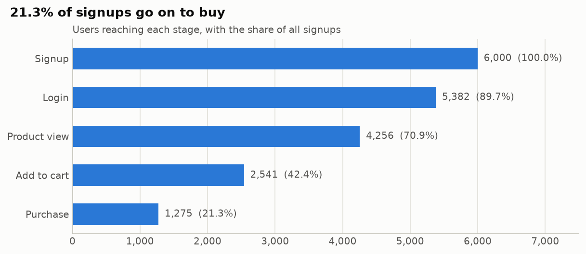
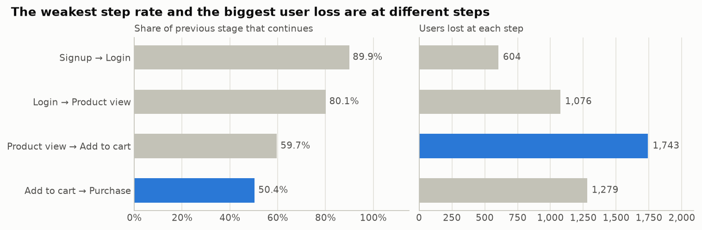
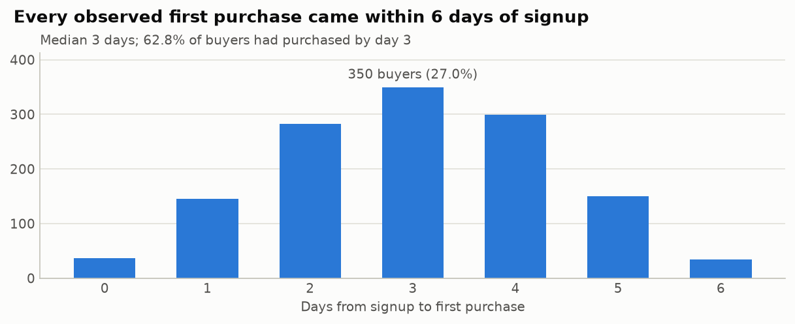
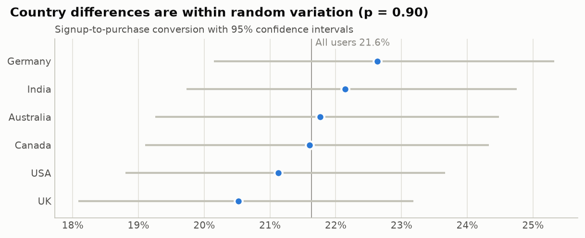
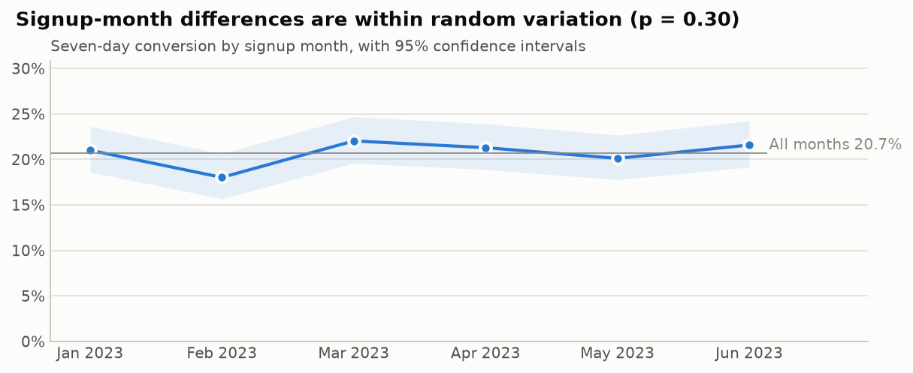

# E-commerce Funnel Analysis

[](https://github.com/omkark2404/ecommerce-funnel-analytics/actions/workflows/ci.yml)
[](https://nbviewer.org/github/omkark2404/ecommerce-funnel-analytics/blob/main/notebooks/funnel_analysis.ipynb)
[](https://www.python.org/downloads/)
[](LICENSE)

Where do users drop out between signing up and buying, how fast do buyers convert, and does any segment behave differently? This project answers those questions for 6,000 accounts and 19,591 events (Jan–Jul 2023) across a five-stage funnel: **signup → login → product view → add to cart → purchase**.

**Data provenance — read this first:** the bundled sample's original source was not recorded and its redistribution rights are unverified; it looks simulated. The results below demonstrate the method on this sample — they are not findings about a real store. A replacement with licensed, reproducible synthetic data is proposed in [PR #7](https://github.com/omkark2404/ecommerce-funnel-analytics/pull/7) and reviewed in [docs/PR7_REVIEW.md](docs/PR7_REVIEW.md). See [data/LINEAGE.md](data/LINEAGE.md).

**Business question:** where do users drop out of the purchase funnel, and what should a team investigate first?

**Tools:** MySQL 8.4 (CTEs, window functions) · Python (pandas, SciPy, matplotlib) · Jupyter · Docker Compose · GitHub Actions

**Full analysis:** [notebooks/funnel_analysis.ipynb](notebooks/funnel_analysis.ipynb)

**KPI definitions:** [docs/KPI_DEFINITIONS.md](docs/KPI_DEFINITIONS.md) — ordered vs any-purchase conversion, the seven-day window (inclusive of day 7), and right-censoring. **Data lineage and limitations:** [data/LINEAGE.md](data/LINEAGE.md).

## Key findings

1. **21.6% of signups make a purchase** (1,298 of 6,000, ordered funnel — the headline KPI). Days-to-purchase and country conversion count any purchase after signup; in this sample that is also 1,298, because no user skips a stage.
2. **The weakest step is add to cart → purchase:** only 50.4% of users with a cart go on to buy. One extra percentage point there is worth about 26 purchases per 6,000 signups — more than at any other step (about 22 at product view → add to cart).
3. **The most users are lost earlier, between product view and add to cart:** 1,743 users, against 1,279 after add to cart. More people reach that step, so a better rate still loses more users in absolute terms.
4. **Buyers convert fast:** every first purchase came within 6 days of signup (median 3 days), and every buyer bought on the day they added to cart or the next day. Among users with a full week of follow-up, 21.5% bought within 7 days.
5. **No segment stands out.** Conversion ranges from 20.5% (UK) to 22.6% (Germany), but a chi-square test finds no significant difference between countries (p = 0.90) or between signup months (p = 0.36), and no individual funnel step differs significantly by country (lowest p = 0.20). With about 1,000 users per country, the tests could reliably detect gaps of about 5 points, so smaller real differences cannot be ruled out.











## Recommendations

These are hypotheses to test with A/B experiments, because observational data cannot show cause and effect.

- **Start after add to cart.** It has the lowest step rate, so each point gained there is worth the most purchases. The data has no checkout-start event, so it cannot separate cart abandonment from checkout abandonment; test changes that cover both, such as showing the total cost earlier, guest checkout, and a cart reminder sent within a day of the cart add (every buyer here bought the same day or the next).
- **Then product pages.** They lose the most users. Test clearer pricing and availability, reviews, and stronger calls to action.
- **Run funnel-wide experiments, not country-specific ones.** No country differs significantly, and one pooled test has more statistical power than six small ones.
- **Improve tracking.** Event timestamps, a checkout-start event, sessions, order values and product IDs would allow session-level funnels and revenue impact.

## How the analysis works

| Step | Where |
| --- | --- |
| Load the CSVs into MySQL via staging tables (validated, then swapped in one transaction) with constraints (primary key, foreign key, allowed event types) | [sql/00_schema.sql](sql/00_schema.sql), [sql/01_load_data.sql](sql/01_load_data.sql) |
| Ordered funnel: a user counts at a stage only after reaching the previous one | [sql/02_funnel_metrics.sql](sql/02_funnel_metrics.sql) |
| Days to first purchase, with a running total from a window function | [sql/03_days_to_purchase.sql](sql/03_days_to_purchase.sql) |
| Conversion by country | [sql/04_country_segmentation.sql](sql/04_country_segmentation.sql) |
| Seven-day conversion, counting only users with a complete seven-day window | [sql/05_seven_day_conversion.sql](sql/05_seven_day_conversion.sql) |
| Data-quality checks in MySQL (duplicates, orphans, events before signup, nulls) | [sql/06_data_quality.sql](sql/06_data_quality.sql) |
| Same metrics in pandas, plus data-quality checks | [src/funnel.py](src/funnel.py) |
| Charts, chi-square tests, 95% confidence intervals, cohort and sensitivity analysis | [notebooks/funnel_analysis.ipynb](notebooks/funnel_analysis.ipynb) |
| Cross-check: run every query in MySQL and compare with the pandas result | [scripts/validate_results.py](scripts/validate_results.py) |
| Check that chart figures fully decode as PNGs and match the current data (via a manifest the notebook writes) | [scripts/check_figures.py](scripts/check_figures.py) |

On every push, CI lints the SQL, lints and format-checks the Python (ruff), runs the unit tests (including MySQL integration tests that compare every field of every query on edge-case data), runs the notebook, confirms the committed CSVs in `outputs/` and the chart manifest are up to date, fully decodes the chart figures and checks them against the current data, loads the data into a MySQL container, and checks that each query returns exactly the same table as pandas — including a record-for-record hash of the loaded tables. See [.github/workflows/ci.yml](.github/workflows/ci.yml).

## Run it

Requires Python 3.12 and, for the MySQL steps, Docker. `make` is used below (Bash / macOS / Linux; on Windows use Git Bash, WSL, or run the commands in the [Makefile](Makefile) directly). The notebook does not need a database.

```bash
git clone https://github.com/omkark2404/ecommerce-funnel-analytics.git
cd ecommerce-funnel-analytics
python -m pip install -r requirements-dev.txt
make test      # unit tests: 73 pass locally; 4 MySQL integration tests are skipped without a database (they run in CI)
make lint      # sqlfluff for SQL, ruff for Python
make check     # lint + tests + ruff format check + figure check
make notebook  # re-run the notebook in place (regenerates outputs/*.csv, outputs/figures/*.png and the figure manifest)
make figures   # check the chart figures decode as PNGs and match the current data
```

To run the SQL against MySQL as well, you need Docker (the `make up` / `validate` / `down` / `reset` steps below; on Windows, run them in WSL or Git Bash with Docker Desktop). Copy `.env.example` to `.env`, set `MYSQL_ROOT_PASSWORD`, then:

```bash
make up        # start MySQL in Docker and load the schema + data
make validate  # run the SQL queries and compare with pandas (also runs the data-quality checks)
make down      # stop MySQL (keeps its data in the named mysql-data volume)
make reset     # stop MySQL and delete its data volume — clean start next time
```

Without `make`, run the commands listed in the [Makefile](Makefile) directly.

## Data and limitations

- **The data looks simulated, and its original source was not recorded.** Every account has at most one event per stage, no account skips a stage, and every step follows the previous one within two days. Real clickstream data does not look like this. The results demonstrate the method; they are not findings about a real store. See [data/README.md](data/README.md) and [data/LINEAGE.md](data/LINEAGE.md). The raw files and cleaning steps are not in this repository — the CSVs here are the cleaned inputs, and `src/funnel.py` refuses to load them if any integrity check fails. **Redistribution rights for the data are unverified; the MIT licence covers the code, not the data files.**
- **Definitions matter:** the ordered funnel (sql/02) counts only purchases reached in stage order, while days-to-purchase and country conversion count any purchase after signup. In this sample both give 1,298 purchasers, because no user skips a stage — on other data they can differ. See [docs/KPI_DEFINITIONS.md](docs/KPI_DEFINITIONS.md).
- **Events have dates, not timestamps,** so the order of stages within a single day is assumed.
- **There is no revenue, order, session or product data,** so the impact is measured in purchases, not money.
- **Segment comparisons are descriptive.** The tests show whether a difference is larger than random variation, not what causes it. Six chi-square tests are run in the notebook (countries, months, and four funnel steps); with a Bonferroni threshold of 0.05 / 6 ≈ 0.008, none is significant — the smallest p-value is 0.20 — so the "no segment stands out" conclusion does not depend on uncorrected testing.
- **The sensitivity table is a sizing tool, not a second finding.** The gain from one extra point at a step is 1% of all purchases divided by that step's own rate, so the lowest-rate step always comes out on top on that scale. Measured as a relative lift, every step is worth the same. The table is useful for weighing what a point is worth against how hard it would be to win.

## Repository layout

```text
data/        Input CSVs and data documentation (README, LINEAGE)
docs/        KPI definitions, PR #7 review, branch-protection guide
sql/         MySQL schema, load script, analysis queries and data-quality checks
src/         pandas implementation of the funnel metrics
notebooks/   Full analysis with charts and statistical tests
scripts/     MySQL vs pandas result validation, figure checks
outputs/     Result CSVs and chart images produced by the notebook
```

Author: Omkar Kumar — analysis, SQL, Python, tests and CI in this repository.
